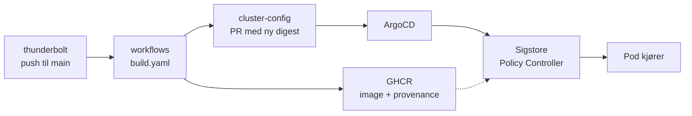

# Thunderbolt

Thunderbolt er et demoprosjekt der vi har bygget og testet en byggekjede for programvare etter [SLSA v1.2](https://slsa.dev/spec/v1.2/) (Supply-chain Levels for Software Artifacts). Målet var å kunne spore et kjørende container-image tilbake til kildekoden det ble bygget fra, og å stoppe images som ikke er bygget på godkjent måte før de kommer inn i clusteret.

Selve appen er en enkel Vite/React-app. Rundt den har vi satt opp bygging med GitHub Actions, signert provenance med Sigstore og verifisering i Kubernetes med Sigstore Policy Controller. Vi undersøkte også hvordan det samme kunne håndheves i Google Cloud Run med Binary Authorization. Det viste seg å være utfordrende å verifisere attesterte images før deploy i Google Cloud Run.

Prosjektet er avsluttet. Vurderinger, kjente mangler og erfaringer er samlet i [sikkerhetsrapporten](./SIKKERHETSRAPPORT.md).

## Repoer

| Repo | Innhold |
|---|---|
| **thunderbolt** (dette repoet) | Appens kildekode, Dockerfile og workflowen som starter bygget |
| [workflows](https://github.com/the-most-secure-supply-chain-ever-maaan/workflows) | Den et reusable workflow repository som bygger, pusher og attesterer imaget |
| [cluster-config](https://github.com/the-most-secure-supply-chain-ever-maaan/cluster-config) | Kubernetes-manifester og ArgoCD-oppsett. ArgoCD deployer det som står her til clusteret |

## Hvordan det henger sammen



1. Push til `main` starter `build.yml`, som kaller byggeworkflowen `build.yaml` i workflows-repoet.
2. Imaget bygges på en GitHub-hostet runner og pushes til GitHub Container Registry (GHCR).
3. `actions/attest` lager SLSA-provenance for imaget. Provenancen signeres med et kortlivet sertifikat fra Sigstore (Fulcio) og logges i Sigstores transparenslogg (Rekor).
4. Provenancen verifiseres, og en PR med den nye digesten opprettes og merges automatisk i cluster-config.
5. ArgoCD deployer endringen. Sigstore Policy Controller sjekker at imaget har gyldig provenance fra byggeworkflowen, og avviser det hvis ikke.

## SLSA

SLSA er et rammeverk med krav til hvordan programvare bygges og dokumenteres, slik at man kan etterprøve hvor et artefakt kommer fra. Kravene er delt inn i spor, hvert med flere nivåer:

- **Build** handler om hvordan imaget bygges og hvordan provenancen lages. Her når vi **L3**: bygget kjører på en fersk runner som slettes etterpå, provenancen signeres av byggeplattformen, og byggestegene er definert i en felles workflow i et eget repo.
- **Source** handler om hvordan kildekoden er beskyttet. Her er vi på **L1**: koden ligger i git, men uten branch protection er historikken ikke beskyttet mot endringer.
- **Dependencies** handler om tredjepartsavhengigheter. Sporet er et utkast og ikke en del av v1.2. Vi bygger med `npm ci --ignore-scripts`, som hindrer at pakker kjører egne skript under installasjon.

Provenance dokumenterer hvor og hvordan et image er bygget. Sårbarheter og ondsinnet kode må fanges opp med andre tiltak, som code review og skanning av avhengigheter.

## Verifisere et image

Krever [GitHub CLI](https://cli.github.com/) (`gh`), innlogget med en bruker som har tilgang til repoene.

```sh
gh attestation verify \
  oci://ghcr.io/the-most-secure-supply-chain-ever-maaan/thunderbolt@sha256:<digest> \
  --owner the-most-secure-supply-chain-ever-maaan \
  --signer-repo the-most-secure-supply-chain-ever-maaan/workflows
```

Digesten står i `apps/thunderbolt/deployment.yml` i cluster-config, eller på pakkesiden for imaget i GHCR. Kommandoen sjekker at imaget har provenance signert av byggeworkflowen i workflows-repoet.

## Kjøre lokalt

Krever Node.js 22 og Docker.

```sh
npm ci --ignore-scripts
npm run dev
```

Med Docker:

```sh
docker build -t thunderbolt .
docker run -p 8080:5731 thunderbolt
```

Appen er da tilgjengelig på http://localhost:8080.

## Les mer

- [SLSA-spesifikasjonen v1.2](https://slsa.dev/spec/v1.2/)
- [GitHub: Using artifact attestations](https://docs.github.com/actions/security-for-github-actions/using-artifact-attestations)
- [Sigstore Policy Controller](https://docs.sigstore.dev/policy-controller/overview/)
